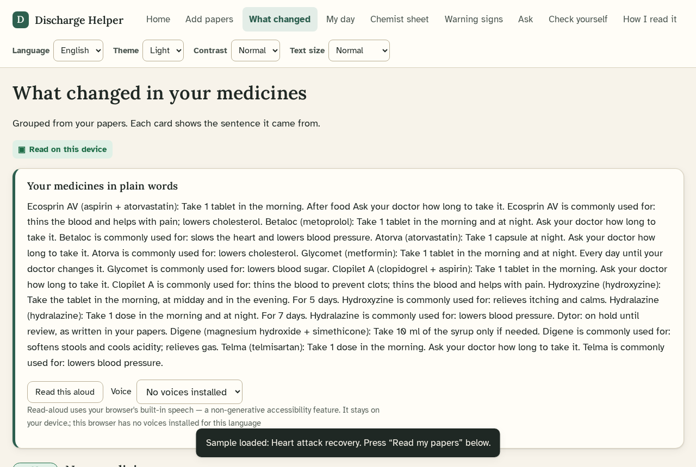
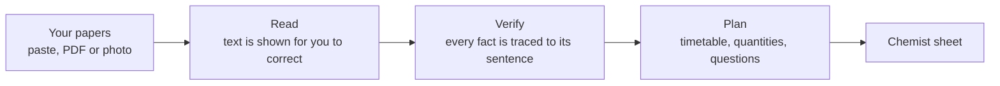

# Discharge Helper

**Turn hospital discharge papers into a plain medicine list, a daily timetable and a one-page sheet for your chemist. Free, private and open source.**

[**Open the live app**](https://sufirumii.github.io/Discharge-Helper/) · [Report a problem](https://github.com/sufirumii/Discharge-Helper/issues) · [How it works](docs/HOW-IT-WORKS.md)



## Why it exists

Discharge summaries are dense, and mistakes with medicines after leaving hospital are common and costly. Discharge Helper reads *your own* papers and shows them back in plain language, so you know what to take, when, and what to ask your doctor.

- No account, no sign-up, no server.
- Your papers never leave your device.
- Works offline once opened.

## What you get

| Screen | What it shows |
|---|---|
| **What changed** | Your medicines before the hospital against the new list, marked new, changed, stopped or same. Each item shows the exact sentence it came from. |
| **My day** | A daily timetable with editable meal times, dated taper and hold steps, refill dates and a calendar download. |
| **Chemist sheet** | Name, brand, strength, form, dose, frequency, days and units needed on one page. Print it, copy it, or share by WhatsApp, QR or link. |
| **Warning signs and questions** | Warning signs from your papers, split into "go to hospital now" and "call your doctor", plus questions to ask about duplicates, look-alike names and unreadable lines. |
| **Check yourself** | A short quiz built from your own papers. |

Press **Try a sample** in the app to see it with a fictional patient. No papers needed.

## How it works



Everything runs in your browser. The reading engine is rule-based, not an AI model, so the same papers always give the same answer. It cannot invent a dose: every result points back to a sentence in your papers, and anything it cannot read is shown as "could not read this line" instead of being guessed.

Photos of printed pages go through a text recogniser that is bundled with the app (also not a language model), and the recognised text is always shown for you to correct first.

## Privacy and safety

- Nothing about your papers is sent anywhere. The security policy only allows the app to talk to itself.
- Papers are stored only in your browser, encrypted, with a one-tap erase.
- The app explains your papers. It never diagnoses, never recommends a medicine and never changes a dose.
- Anything unclear or missing becomes a question for your doctor.
- The emergency number 112 is visible on every screen.
- It is **not** a substitute for your care team.

More detail: [docs/SAFETY.md](docs/SAFETY.md).

## Limits

- Handwriting is not supported. Typed or printed papers work best.
- The medicine list is finite: 259 ingredients and 298 brands. Unknown drugs are flagged and copied exactly, not interpreted.
- Hindi and Telugu are reviewed templates, not free translation.
- No interaction checking and no dose-range checking.
- Dates are read day-first, and unclear dates are flagged "please confirm".

On 12 synthetic discharge summaries written for this project, medicine-name recall and precision are both 100%. With OCR-style character noise, recall drops to 80.2%. This is a regression check, not clinical validation. See [eval/report.md](eval/report.md).

## Run it yourself

You need Node 20 or newer.

```bash
git clone https://github.com/sufirumii/Discharge-Helper.git
cd Discharge-Helper
npm ci
npm run dev
```

Then open the address shown in the terminal.

| Command | What it does |
|---|---|
| `npm run dev` | Start the local dev server |
| `npm run build` | Build the site into `dist/` |
| `npm test` | Run the unit tests |
| `npm run eval` | Run the evaluation corpus and write `eval/report.md` |
| `npm run verify` | Lint, typecheck, tests, lexicon check, eval, build and repo check |
| `npm run test:e2e` | End-to-end tests with Playwright |

## Publish your own copy on GitHub Pages

1. **Fork** this repository (or push your own copy to GitHub).
2. Go to **Settings → Pages** and set **Source** to **GitHub Actions**.
3. Push to `main`, or run the **Deploy to GitHub Pages** workflow from the **Actions** tab.

When the run turns green, your site is at `https://<your-username>.github.io/<repo-name>/`. The build uses relative paths, so it works under any repository name with no configuration. The same `dist/` folder also works on Netlify, Vercel, Render or any static host.

## Project layout

```
src/engine/    the rule-based reading engine (parsing, dates, quantities, checks)
src/ui/        screens and components (React)
src/intake/    PDF text extraction and photo text recognition
src/storage/   encrypted local storage
src/share/     chemist-sheet sharing (link, QR, WhatsApp)
src/i18n/      English, Hindi and Telugu phrase tables
data/          medicine lexicon and its sources (every row has a source and licence)
eval/          the synthetic test corpus and its report
docs/          how it works, safety, data sources, contributing
```

## Contributing

Contributions are welcome: new medicines, translations, test cases and fixes. Start with [docs/CONTRIBUTING.md](docs/CONTRIBUTING.md). Please run `npm run verify` before opening a pull request.

## Licence

Apache-2.0. See [LICENSE](LICENSE). Medicine data sources and their licences: [docs/DATA-SOURCES.md](docs/DATA-SOURCES.md).
